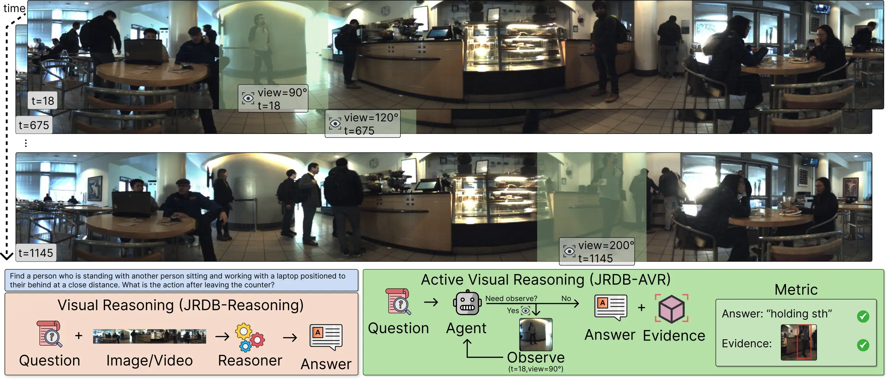

# JRDB-AVR: An Active Visual Reasoning Benchmark for Embodied Agents in Real-World Environments

<div align="center">
    
    <p></p>
</div>

<div align="center">
    <a href="https://github.com/ControlNet/JRDB-AVR/issues">
        
    </a>
    <a href="https://github.com/ControlNet/JRDB-AVR/network/members">
        
    </a>
    <a href="https://github.com/ControlNet/JRDB-AVR/stargazers">
        
    </a>
    <a href="https://github.com/ControlNet/JRDB-AVR/blob/master/LICENSE">
        
    </a>
    <a href="https://arxiv.org/abs/2609.35032">
        
    </a>
    <a href="https://neurips.cc/Conferences/2026">
        
    </a>
</div>


**This repo is the official repository for the paper [JRDB-AVR: An Active Visual Reasoning Benchmark for Embodied Agents in Real-World Environments](https://arxiv.org/abs/2609.35032), accepted at NeurIPS 2026 (Track on Evaluations and Datasets).**

## News

- [2026/09/28] 🔥 **JRDB-AVR** paper is released on [arXiv](https://arxiv.org/abs/2609.35032).
- [2026/09] 🎉 **JRDB-AVR** paper is accepted at NeurIPS 2026.

## Abstract

In complex embodied visual reasoning scenarios, an agent often has only a limited field of view, and the evidence needed to answer a question may be distributed across time, viewpoint, and interacting objects. A model may therefore give a plausible answer without ever observing the relevant object, time, or view that supports it. Current visual reasoning benchmarks largely evaluate passive observations and final answers, overlooking settings that require active reasoning and evidence acquisition. We introduce JRDB-AVR, a benchmark derived from existing real-world JRDB robotics data through a structured question-generation engine that turns this gap into an explicit evaluation: an embodied agentic system receives a visual reasoning question, requests bounded observations by timestamp and viewing angle, and is evaluated on both the final answer and the grounded visual evidence supporting it. The benchmark contains diverse questions over multiple real-world environments involving temporal search, viewpoint selection, and human-oriented compositional reasoning. We also introduce JRDB-AVR-Agent, a reference active reasoning agentic method that maintains an explicit observation-grounded graph-based world model and answers through solving. Experiments reveal a substantial gap between answer accuracy and evidence accuracy in current baselines, showing that current VLMs can produce unsupported correct answers and that active evidence-aware evaluation is necessary for embodied visual reasoning.

## Benchmark

JRDB-AVR is generated from the 27 JRDB test sequences using the annotations of [JRDB](https://jrdb.erc.monash.edu/) and its extension datasets (JRDB-Act, JRDB-Pose, JRDB-PanoTrack, JRDB-Social and JRDB-Reasoning). The released benchmark contains **2,098 active VQA questions**.

### Observation Interface

The agent is not given the full panorama up front. Instead, it actively requests observations through

```python
observe(sequence, frame_index, angle_deg)
```

which returns a 480×480 RGB crop, with metadata, rendered from the stitched JRDB panoramic video (3760×480, 15 FPS).

### Evaluation Metrics

A prediction contains the answer and the visual evidence, i.e. the target localization by timestamp and bounding box.

- **Answer**: multiple choice by choice index, frames within ±1 second, temporal segments with IoU ≥ 0.5, numeric values with prediction-to-ground-truth ratio in [0.5, 2.0], and frame-viewpoint pairs within ±1 second and ±20°.
- **Evidence**: the predicted target must be correct and, when box annotations are available, the predicted bounding box must exceed the IoU threshold in a frame where the target appears.
- **Combined**: a question is counted as correct only when both the answer and the evidence are correct.
- **Hallucination**: the conditional rate of answer-correct predictions without correct evidence, `(Answer - Combined) / Answer`.

## Data

JRDB-AVR depends on the original JRDB dataset, which must be obtained separately from https://jrdb.erc.monash.edu/. Any use of the original JRDB data must comply with the license terms of the JRDB dataset.

## Citation

If you find this work useful for your research, please consider citing it.

```bibtex
@inproceedings{cai2026jrdbavr,
  title = {JRDB-AVR: An Active Visual Reasoning Benchmark for Embodied Agents in Real-World Environments},
  author = {Cai, Zhixi and Ke, Fucai and Huang, Sukai and Garcia de la Banda, Maria and Stuckey, Peter J. and Haffari, Gholamreza and Rezatofighi, Hamid},
  booktitle = {Advances in Neural Information Processing Systems},
  year = {2026},
}
```

## License

This project is released under the [Apache-2.0 License](LICENSE). The JRDB data used by the benchmark is subject to the license terms of the JRDB dataset.
